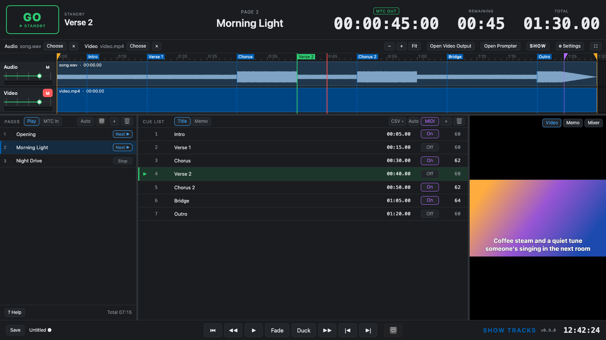
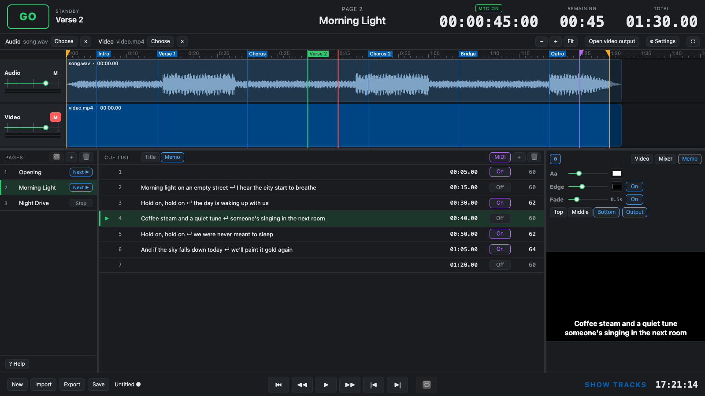
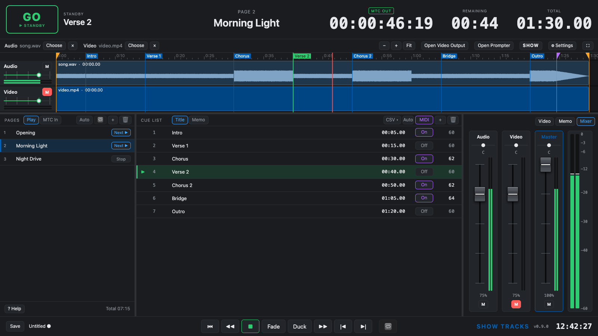

# Show Tracks

**English** | [日本語](README.ja.md)

A playback-only web app for live shows. Put one song on each page, mark cues on it, and play the show in order. At each cue it can show lyrics or prompts on screen and send a MIDI Note, and it sends MTC as it plays.

There is no editing. You can only set where each song starts and ends, so there is little to get wrong during a show.

> [!IMPORTANT]
> **Desktop Chrome only.** Show Tracks does not work on smartphones or tablets. It relies on a keyboard, a separate output window, and Chrome features such as Web MIDI and the File System Access API.

**Open the app: https://hugesesame.github.io/show-tracks/**

> **This is a beta.** Show Tracks is still being tested and has not been used in a real show yet. MTC and MIDI Notes have been checked with real equipment. Try it with your own equipment before using it in a show.



## What it does

- **Pages set the running order.** Each page holds one audio file and one video file. At the end of a page it can stop, open the next page, or play it.
- **Cues** are markers on the track. Press **GO** (or `G`) to play from the cue on standby, and step through them in the **Cue List**.
- **In and out points** play only part of a song.
- **Overlap**: a mark near the end of a song starts the next page there, while the end of the song rings out underneath. This is for audio files: the video does not overlap.
- **Text on screen at each cue**: lyrics in time with the music, prompts for performers, or text over the video for a karaoke-style picture. Choose the size, color, outline, position and a dissolve between lines.
- **MIDI Note at each cue**, to control lights or other gear. Turn it on or off per cue or for a whole page.
- **MTC** follows the playback time, with an offset per page.
- **Video output window** for a second display, with the text over the video. The main screen frames the picture the same way, so what you see is what the audience sees.
- **Mixer** with Audio, Video and Master faders, pan and mute.
- **Help** in English and Japanese inside the app: press `?`.





## Getting started

1. Open the app in desktop Chrome.
2. On the first page, press **Choose** next to Audio (and Video, if there is one) and pick a file. Any format Chrome can play works, such as WAV, MP3, M4A and MP4.
3. Play it with `Space`, and press `M` where you want a cue. Add more pages with **+** in PAGES.
4. For lyrics or prompts, switch the Cue List to **Memo** and double-click a cue to type. `Shift+Enter` starts a new line.
5. Press **Open video output** and move the window to the second display. Double-click it or press `F` for fullscreen.
6. For MTC and MIDI Notes, open **Settings** (`⌘,`) and choose the MIDI output.

Press `?` or **Help** at the bottom of PAGES for all the controls and keyboard shortcuts.

### What the browser asks you

The browser asks for permission the first time. Choose **Allow**. If you blocked it by mistake, click the icon at the left of the address bar and change the setting there.

| When | What the browser asks | Why |
|---|---|---|
| The app opens | To control MIDI devices | To send MTC and MIDI Notes |
| You press **Open video output** | To allow pop-ups (only if the window was blocked) | To open the output window |
| You press **Save** the first time | Where to save the file | To write the project file |

On a Mac, the **IAC Driver** in Audio MIDI Setup sends MIDI to other apps on the same computer.

## Where your show is kept

- Your show and its audio and video are saved automatically in this computer's browser as you work.
- Nothing is sent anywhere. The show is not on other computers, or in other browsers on the same computer.
- Clearing the browser's site data deletes the show and its media too.
- **Save** (`⌘S`) writes the project to a file wherever you choose. Use it for backups, and to move a show to another computer with **Import**.
- **The project file does not include audio or video.** On another computer, choose the media again on each page.

## Without an internet connection

- Once the app is open, it keeps working if the connection drops. Playback, MTC, MIDI and the output window do not use the internet.
- Reloading the app needs a connection. Open it before you lose the connection, and keep it open.

## Running it on your own computer

This part is for people who want to change the app or build it themselves. You do not need it to use the app — just open the link above. It needs Node.js 20.19+ or 22.12+.

```bash
npm install
npm run dev
```

Open the address that appears in the terminal (normally http://localhost:5173/).

| Command | What it does |
|---|---|
| `npm run dev` | Start the dev server; changes to the code show up right away |
| `npm run build` | Type-check and build the app into a single file, `dist/index.html` |
| `npm run preview` | Open the built app from `dist/` locally |
| `npm test` | Run the tests |

The public site and your local copy keep their saved shows apart. Use **Save** and **Import** to move a show between them.

| Path | Contents |
|---|---|
| `src/app/` | App state and actions |
| `src/engine/` | Playback, the two audio decks, the mixer, MTC and MIDI output |
| `src/cue/` | GO and the cue on standby |
| `src/model/` | Pages, cues, in / out points, overlap and memos |
| `src/media/` | Reading audio and video files, and the waveform |
| `src/ui/` | The main screen: track, pages, Cue List, mixer, memo view, settings, help |
| `src/output/` | The video output window |
| `src/storage/` | Saving in the browser and project files |
| `tests/` | Tests |

Built with TypeScript and Vite, without a UI framework.

## License

[MIT](LICENSE). You are free to use, change and share Show Tracks, including at work. It comes with no warranty.
